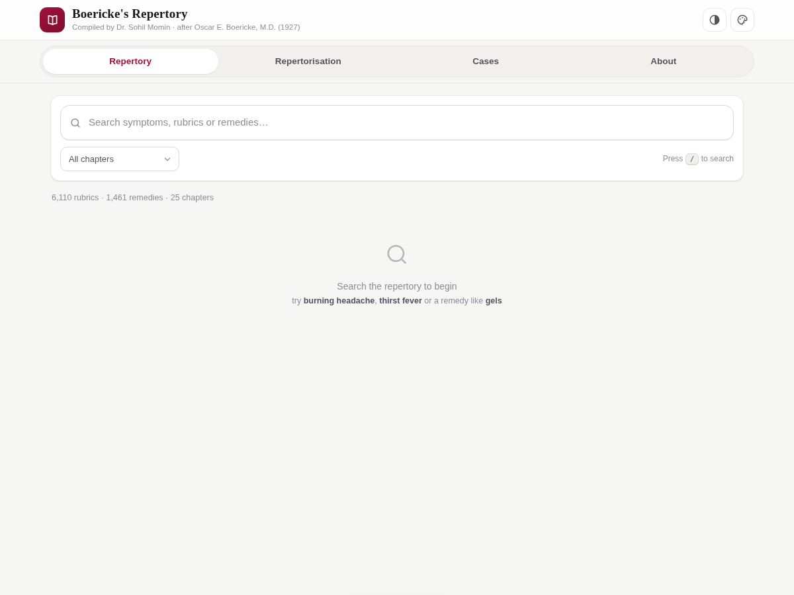
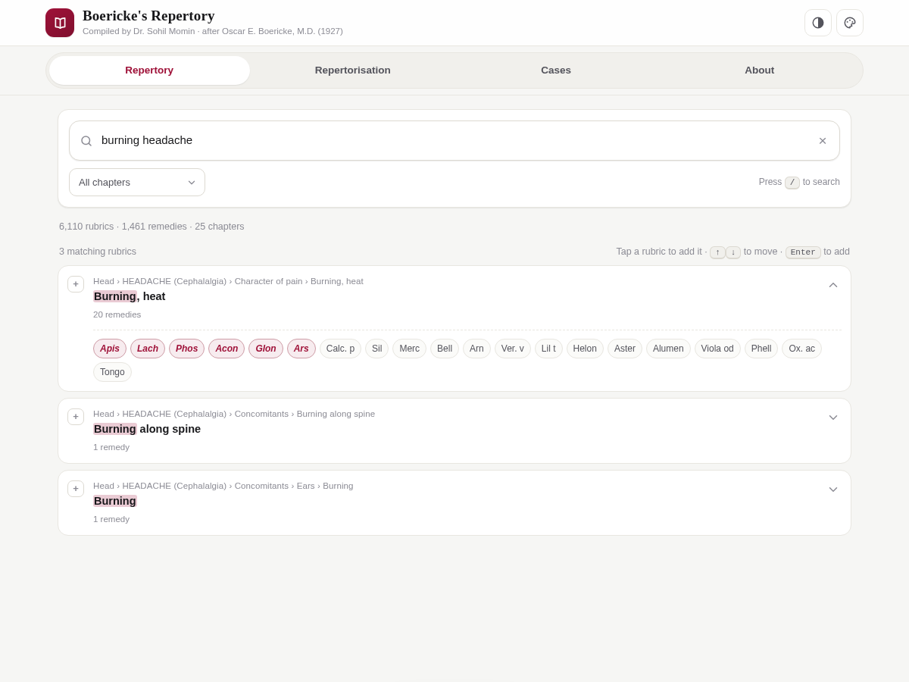
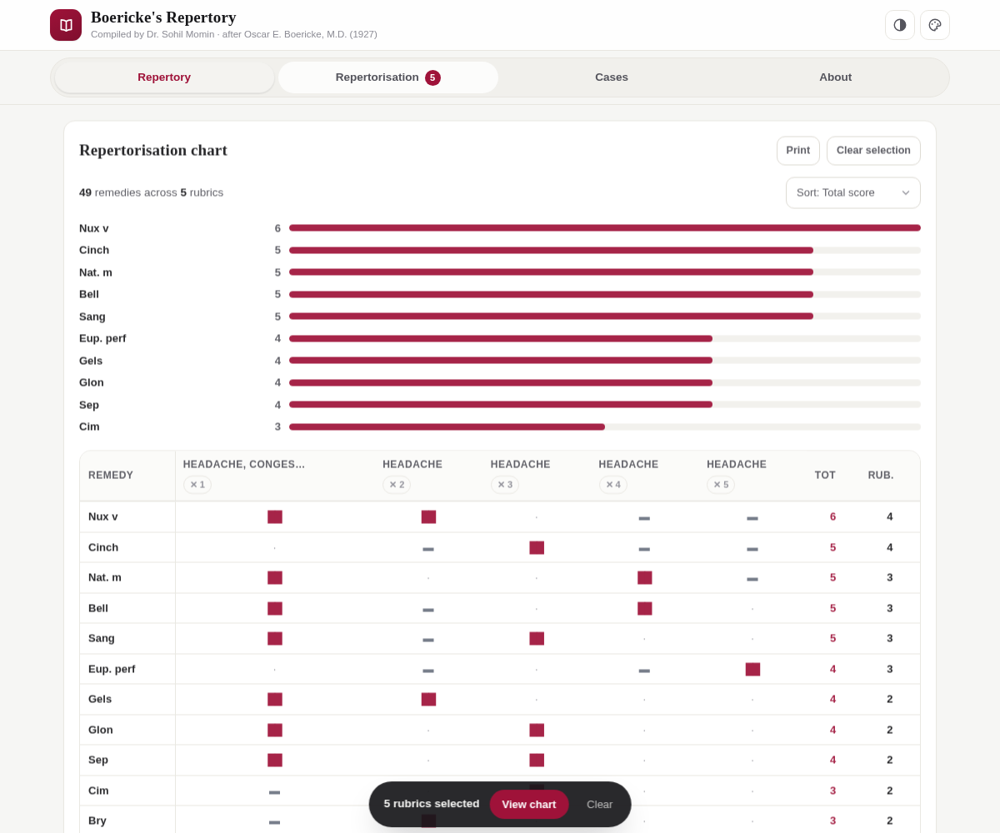

# Boericke's Repertory

<!-- shot:start -->

<!-- shot:end -->

### A classic repertory, made searchable — a free, offline clinical repertory &amp; repertorisation tool in one HTML file

**Compiled and designed by Dr. Sohil Momin** · after *Oscar E. Boericke, M.D. (1927)*

**Landing page:** <https://drsamonline.github.io/boericke-repertory/>
&nbsp;·&nbsp;
**Live demo:** <https://drsamonline.github.io/boericke-repertory/play/>

**Download:** [Windows (.exe)](https://github.com/drsamonline/boericke-repertory/releases/latest/download/boericke-repertory-portable.exe) &nbsp;·&nbsp; [Android (.apk)](https://github.com/drsamonline/boericke-repertory/releases/latest/download/boericke-repertory.apk)

---

## ▶️ Live app

**<https://drsamonline.github.io/boericke-repertory/play/>** — open in any browser, nothing to install.
Works offline once loaded, and on phone, tablet or desktop.

| Search | Repertorisation |
| :---: | :---: |
|  |  |

---

## ✨ Features

**🔎 Search** — instant results across 6,110 rubrics by symptom, path or remedy name, with
matched terms highlighted and a chapter filter. Full keyboard control: `/` to focus,
`↑` `↓` to move, `Enter` to add.

**🧮 Repertorise** — tap rubrics to build a chart that scores every remedy across them
(italic *grade 2* = 2 points, plain *grade 1* = 1 point) and ranks by total. Sort by
total, rubric count or remedy name, with top-10 remedy bars.

**🧪 Remedy browser** — tap any remedy inside a rubric to see **every rubric that lists it**,
with its grade — a fast way to check a remedy's full clinical picture.

**🗂️ Cases** — save patient details, notes and prescription alongside the rubric selection
and chart; reload, print, export or import as JSON.

**📄 Print & export** — print the chart straight from the app (no pop-ups).

**🎨 Looks** — modern responsive UI, light / dark / auto themes, five accent colours.

**🔒 Private & offline** — one self-contained HTML file. No server, no build step, no
internet needed after loading, no tracking, no dependencies.

---

## 🚀 Use it

**Online:** open the [live app](https://drsamonline.github.io/boericke-repertory/play/).

**Offline:** download [`index.html`](index.html) and open it in any modern browser —
that's the whole installation.

**Self-host:** fork this repo and enable GitHub Pages
(*Settings → Pages → deploy from the default branch*).

---

## 📊 Data

| | |
| :-- | --: |
| Rubrics | **6,110** |
| Unique remedies | **1,461** |
| Chapters | **25** |

The dataset has been cleaned: remedies are de-duplicated (OCR variants merged into one
canonical name), duplicate rubrics are merged, and remedy-less category headings are kept
for structure but never appear in search results — so every rubric shown carries at least
one remedy.

---

## 🙏 Credits

- **Content** — *Repertory* by **Oscar E. Boericke, M.D.** (1927), companion to the
  *Pocket Manual of Homoeopathic Materia Medica*, 9th ed., by **William Boericke, M.D.**
  Text digitised from the public-domain edition at homeoint.org (presented by Médi-T).
- **Design & application** — © 2026 **Dr. Sohil Momin**.

---

## 📜 Licence

**Free to use** — copy, modify and distribute, **provided that attribution is given**:

> Content: *Repertory by Oscar E. Boericke, M.D. (1927)*
> Design & application: *Dr. Sohil Momin*

Attribution is **compulsory in all copies and derivative works**, in both the
documentation and the user interface. See [LICENSE](LICENSE) for the full terms.

---

**⚠️ Disclaimer** — Provided *as is*, for study and reference by qualified practitioners.
Not a substitute for professional homoeopathic or medical judgment.

Boericke's Repertory · Digital Edition · compiled by Dr. Sohil Momin

