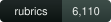
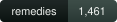
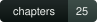
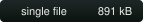
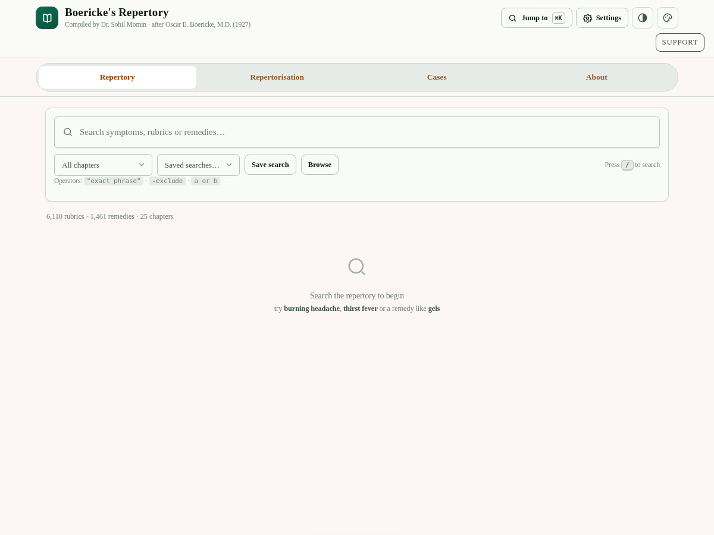
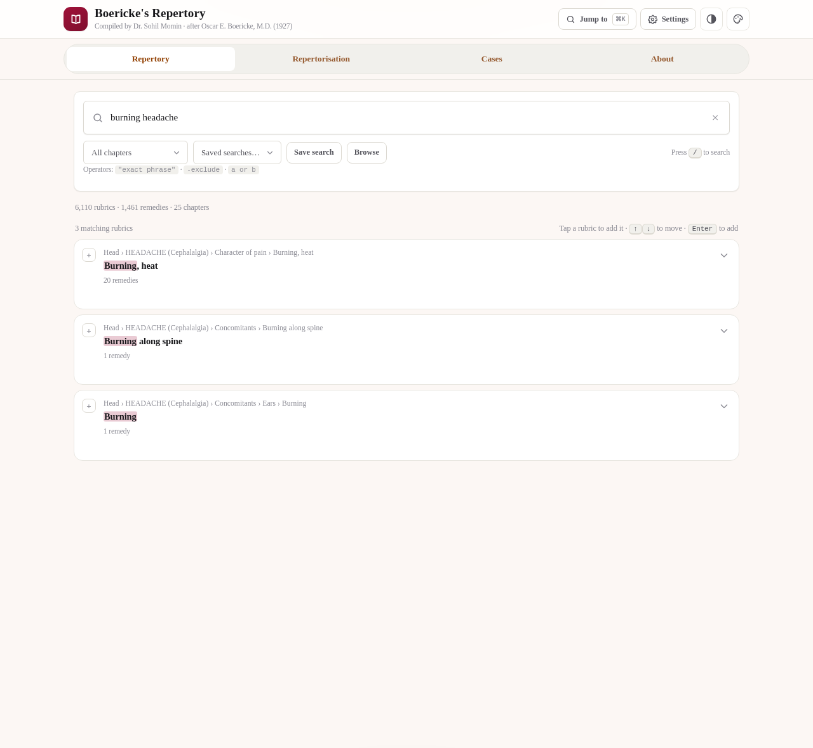
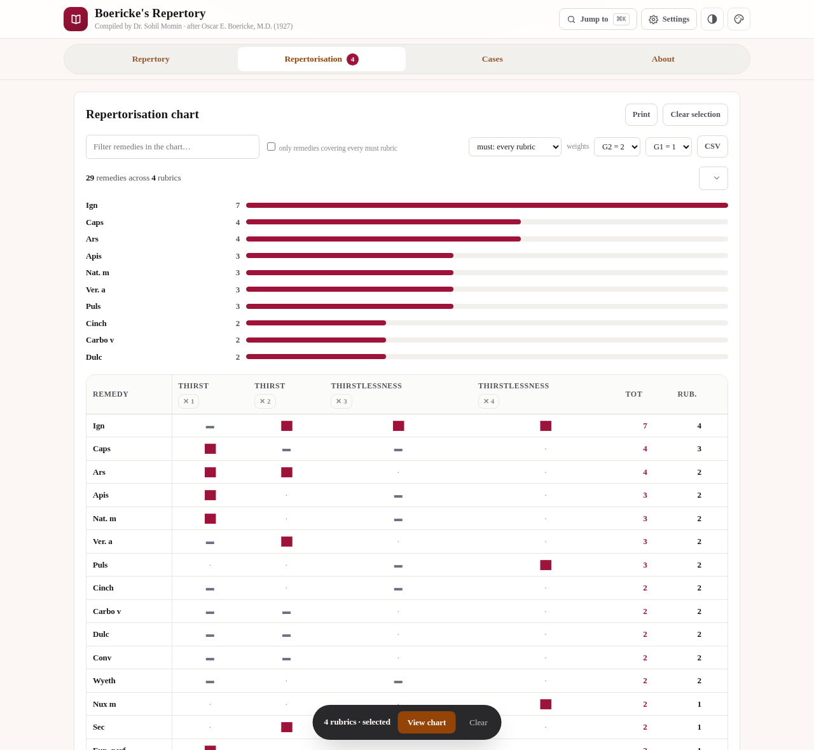

<div align="center">

# Boericke's Repertory

      

### A classic clinical repertory, made searchable — one HTML file, offline, no account, no server

**Compiled and designed by Dr. Sohil Momin** · after *Oscar E. Boericke, M.D. (1927)*

[**Landing page**](https://drsamonline.github.io/boericke-repertory/) &nbsp;·&nbsp;
[**Live app**](https://drsamonline.github.io/boericke-repertory/play/) &nbsp;·&nbsp;
[**Releases**](https://github.com/drsamonline/boericke-repertory/releases/latest) &nbsp;·&nbsp;
[**Roadmap**](docs/ROADMAP.md) &nbsp;·&nbsp;
[**Licence**](LICENSE)

[Windows `.exe`](https://github.com/drsamonline/boericke-repertory/releases/latest/download/boericke-repertory-portable.exe) &nbsp;·&nbsp;
[Android `.apk`](https://github.com/drsamonline/boericke-repertory/releases/latest/download/boericke-repertory.apk) &nbsp;·&nbsp;
[`index.html`](https://github.com/drsamonline/boericke-repertory/raw/main/docs/play/index.html)

</div>

<!-- shot:start -->



<!-- shot:end -->

<div align="center">

| Search | Repertorisation |
| :---: | :---: |
| [](docs/assets/app-desktop.png) | [](docs/assets/app-chart-desktop.png) |

</div>

---

## What it is

Boericke's *Repertory* is the index to a homeopathic practice: a symptom path, a rubric, and the
remedies that belong to it, graded. This is that book as **one 903 kB HTML file** — the
stylesheet, the script and the whole dataset inline. Open it in a browser and it runs; there is
no install, no build step, no server and no account.

It is built for the consulting room, which is why it is offline-first rather than
offline-tolerant: once the page has loaded it never opens a socket. No CDN, no web font, no
analytics, no telemetry, no badge service — **including on the landing page that advertises it.**

## What it does

**Search like a query.** Instant results across 6,110 rubrics with real operators —
`"exact phrase"`, `-exclude`, `a or b` — and typo tolerance that only kicks in when nothing at
all matched. Remedy aliases mean *Gelsemium* finds the source's own *Gels*. `/` focuses the box,
`↑` `↓` move, `Enter` adds to the chart.

**Browse the book.** A **Browse** toggle walks the repertory by chapter and sub-rubric, expanded
lazily, so you can navigate the way the book is laid out instead of guessing at words.

**Repertorise, then eliminate.** Every selected rubric scores its remedies — grade 2 counts two
points, grade 1 counts one, and you can change both weights (the scale is printed on the chart
and in the print sheet, so a chart stays auditable). Mark a rubric **must-have** and every remedy
that misses one is faded, or filtered out entirely. Filter the table by name; tap any remedy to
see every rubric that lists it.

**Keep the case.** Patient details, notes and prescription sit alongside the selection and the
chart, grouped by patient. Cases can be **locked with a passphrase** — AES-256-GCM, key derived
with PBKDF2-SHA256 (200,000 rounds) in the browser and never stored. Print a one-page A4 case
sheet, export the chart as CSV, export every case as JSON, or save straight to a file you choose.

**Work fast.** A command palette on `Ctrl`/`Cmd + K`, undo on `Ctrl`/`Cmd + Z`, saved searches,
per-rubric notes, and computed "similar rubrics" for a rubric you are unsure about.

**Cite it.** Every rubric has a `❝` button that produces a citable reference — path, chapter,
edition, and the remedies split by grade — ready to paste into a case note. The author's own 1927
prefatory note is quoted in full in About, because it explains the arrangement better than any
summary could.

**Checked against the source.** Every rubric was aligned to a complete transcription of the 1927
text and compared remedy by remedy, grade by grade: **5,319 of 5,415** are identical, and the **96**
that differ are listed in the app with the source's own line and the exact disagreement. About →
Source check shows the totals; the ⚠ mark on a row means "look here". See [`SOURCES.md`](SOURCES.md).

**Refuses to phone home.** No account · no server · no network after load · no external assets ·
no telemetry · no silent updates.

## What's new in 1.6.0

English-only interface · elimination by repertory section · patient visit history with a "New
visit" action · a versioned release strip on the landing page.

## What's new in 1.5.1

A final audit as a script (`scripts/audit.py`, 29 checks) · the second-repertory plan removed ·
dead code removed.

## What's new in 1.5.0

Every rubric verified against the 1927 text · the 96 disagreements published, not hidden · the
verdict shown in the citation sheet.

## What's new in 1.4.0

A citation for any rubric · the author's prefatory note quoted in full · [`SOURCES.md`](SOURCES.md)
recording what came from where, and what could not be obtained.

## What's new in 1.3.0

The interface briefly shipped in three languages (removed in 1.6.0 — English only) · `?lang=` deep links · the release pipeline now embeds the real icon
(`docs/play/icon.png` is the file `app-builder` looks for first).

## What's new in 1.2.0

Query operators and typo tolerance · browse-by-chapter · must-have rubrics · configurable grade
weights · chart filter · encrypted vault · patient grouping and case search · command palette ·
undo · saved searches · per-rubric notes · similar rubrics · one-page case sheet · CSV export ·
backup reminder · service worker and installable manifest · text-size and high-contrast settings ·
data audit · remedy alias table. See the [changelog](CHANGELOG.md) and the
[roadmap](docs/ROADMAP.md) for what is deliberately not done.

## Use it

| | |
| :-- | :-- |
| **Online** | [drsamonline.github.io/boericke-repertory/play/](https://drsamonline.github.io/boericke-repertory/play/) |
| **Offline** | download [`index.html`](index.html) and open it — that is the whole installation |
| **Windows / Android** | the portable `.exe` and the signed `.apk` on [Releases](https://github.com/drsamonline/boericke-repertory/releases/latest) |
| **Self-host** | fork the repo, enable GitHub Pages, deploy from the default branch |

## The data

| | |
| :-- | --: |
| Rubrics | **6,110** |
| Unique remedies | **1,461** |
| Chapters | **25** |
| Graded entries | **48,385** (15,737 at grade 2) |
| Remedies with no rubric | **0** |
| Runtime dependencies | **0** |

The dataset is cleaned, not copied: OCR variants of a remedy name are merged into one canonical
name, duplicate rubrics are merged, and remedy-less category headings are kept for structure but
never appear in search results — so every rubric shown carries at least one remedy. The **About →
Data audit** panel recomputes these numbers in the app, so the cleaning can be checked rather than
trusted.

## The repository

```
docs/index.html             the landing page (its own design, not the app's)
docs/play/index.html        the app as deployed
docs/play/sw.js             service worker: network-first HTML, cache-first assets
docs/play/manifest.webmanifest
docs/play/icon.png          the mark app-builder embeds in the .exe and .apk
docs/assets/                screenshots, local SVG badges, generated icons
docs/ROADMAP.md             the offline-only enhancement list
SOURCES.md                  provenance: what came from where, how it was verified, what could not
scripts/badges.py           draws docs/assets/badge-*.svg — no image service
scripts/icons.py            rasterises the icon: PNG sizes, .ico, adaptive layers
scripts/social.py           draws the 1280x630 social card
scripts/shot.sh             headless-Chromium screenshots of both surfaces
scripts/check.sh            syntax check + self-test + vault test, one command
scripts/audit.py            every claim in this repo, checked against this repo
tools/selftest.html         28 assertions driving the app through its own API
scripts/vault_test.mjs      6 assertions on the encryption round trip
```

```bash
bash scripts/check.sh         # syntax + 28 browser assertions + 6 crypto assertions
python3 scripts/audit.py      # 29 checks: offline promise, versions, counts, links
python3 scripts/badges.py     # regenerate the badges
python3 scripts/icons.py      # regenerate the icons, .ico and adaptive layers
bash scripts/shot.sh landing  # screenshot the landing page
bash scripts/shot.sh app app '?q=burning%20headache'
```

The build pipeline (`.github/workflows/build-apps.yml`) builds the `.exe` and the `.apk` from
`docs/play`, publishes the rolling release and deploys `docs/` to Pages — all from one commit, so
the live demo and the released build can never disagree.

## Credits

- **Content** — *Repertory* by **Oscar E. Boericke, M.D.** (1927), companion to the *Pocket
  Manual of Homoeopathic Materia Medica*, 9th ed., by **William Boericke, M.D.** Text digitised
  from the public-domain edition at homeoint.org (presented by Médi-T).
- **Design & application** — © 2026 **Dr. Sohil Momin**.

## Support


Free, offline, accountless — and staying that way. If it earned its keep:

| | |
|---|---|
| UPI (India) | `drsohilboi@ybl` — payee Dr. Sohil Momin, open amount, or scan [the QR](docs/assets/upi-qr.svg) |
| Ko-fi | [ko-fi.com/matneo](https://ko-fi.com/matneo) |
| PayPal | [paypal.me/drsohilmomin](https://paypal.me/drsohilmomin?locale.x=en_GB&country.x=IN) |
| My books | [Amazon author store](https://www.amazon.com/stores/author/B08ZT331LY/allbooks?ccs_id=aed72b9f-71d9-41dc-adee-e9368a317acc) |
| More apps | [drsamonline.github.io](https://drsamonline.github.io/) |
| Email | [sohilmomin2000@gmail.com](mailto:sohilmomin2000@gmail.com) |

Nothing is gated behind it: no accounts, no tracking, no network requests.

## Licence

**Free to use, with attribution.** Copy, modify and distribute, provided that attribution is
given in both the documentation and the user interface:

> Content: *Repertory by Oscar E. Boericke, M.D. (1927)*
> Design & application: *Dr. Sohil Momin*

See [LICENSE](LICENSE) for the full terms.

<div align="center">

**Disclaimer** — provided *as is*, for study and reference by qualified practitioners.
Not a substitute for professional homoeopathic or medical judgment.

</div>
